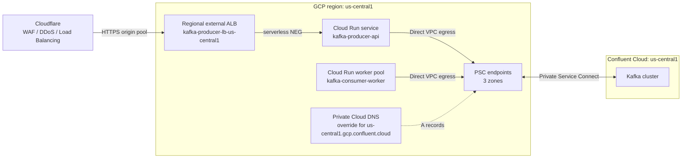

# Confluent Cloud on Google Cloud Run

Reference architecture, production notes, and TypeScript examples for running Kafka producers and consumers on Google Cloud Run with Confluent Cloud.

This repository focuses on the parts that are easy to get wrong:

- Private networking between Cloud Run and Confluent Cloud using Private Service Connect (PSC), PSC Global Access, and private Cloud DNS.
- Cloudflare edge routing with WAF, DDoS protection, and Load Balancing in front of regional external Application Load Balancers and Cloud Run serverless NEGs.
- Multi-region Confluent clusters with Cluster Linking, wired for active-active where the domain allows and warm active-passive otherwise.
- Correct producer and consumer configuration for `@confluentinc/kafka-javascript` (librdkafka).
- Cloud Run lifecycle behavior: startup probes, readiness probes, Direct VPC egress startup delay, SIGTERM draining, `min-instances`, and worker pools.
- Consumer scaling and offset management without duplicate processing surprises.

## Architecture



The same pattern is repeated per region:

- Cloudflare Load Balancing with one origin pool per region and health checks against `/readyz`.
- One regional external Application Load Balancer and one serverless NEG per region.
- One Confluent cluster per region.
- One PSC service attachment per Confluent cluster and availability zone (`/26` subnet, three endpoints for three zones).
- PSC Global Access enabled on each endpoint as a fallback for cross-region access.
- Direct VPC egress on the Cloud Run service or worker pool.
- A private Cloud DNS zone with one A record per PSC endpoint.
- Cluster Linking between regional clusters; producers and consumers always use the local cluster.

See [docs/architecture.md](docs/architecture.md) for the full topology and trade-offs.

## Repository layout

```text
src/
  config.ts             Environment parsing and validation
  logger.ts             Structured JSON logging for Cloud Logging
  kafka.ts              Producer, consumer, admin, retry, and rebalance setup
  lifecycle.ts          SIGTERM/SIGINT graceful shutdown
  producer-service.ts   HTTP producer service for Cloud Run services
  consumer-worker.ts    Batch consumer for Cloud Run worker pools
  create-topics.ts      Idempotent topic provisioning
  check-connectivity.ts PSC/DNS/auth verification
docs/
  architecture.md
  networking.md
  publishing.md
  subscribing.md
  cloud-run.md
  multi-region.md
  failover-routing.md
  operations.md
```

## Quick start

```bash
cp .env.example .env
# Edit .env with your Confluent bootstrap server, API key, and secret.

npm ci
npm run lint
npm run build

npm run create-topics
npm run check-connectivity

# Terminal 1
npm run dev:producer

# Terminal 2
npm run dev:consumer

# Terminal 3
curl -sS -X POST http://localhost:8080/publish \
  -H 'content-type: application/json' \
  -d '{"key":"order-1","value":{"eventId":"evt-1","type":"order.created"}}'
```

The producer exposes:

- `GET /healthz` and `GET /readyz` for Cloud Run startup/readiness probes and Cloudflare Load Balancing health checks. `/readyz` must include a bounded Kafka check before it is used as the sole failover signal.
- `POST /publish` with a JSON body of `{ "key": "...", "value": {...}, "headers": {...} }`.

The consumer uses manual offset commits, batch processing, and rebalance-aware commits.

## Cloud Run deployment sketch

Build one image and use it for both workloads:

```bash
gcloud builds submit \
  --tag us-central1-docker.pkg.dev/PROJECT_ID/REPO/kafka-app:latest
```

Deploy the producer as a Cloud Run service behind a regional external ALB and Cloudflare:

```bash
gcloud run deploy kafka-producer-api \
  --image us-central1-docker.pkg.dev/PROJECT_ID/REPO/kafka-app:latest \
  --region us-central1 \
  --network kafka-vpc \
  --subnet kafka-run-us-central1 \
  --vpc-egress private-ranges-only \
  --allow-unauthenticated \
  --ingress internal-and-cloud-load-balancing \
  --min-instances 2 \
  --max-instances 50 \
  --cpu 1 \
  --memory 512Mi \
  --timeout 30 \
  --no-cpu-throttling \
  --readiness-probe httpGet.path=/readyz,httpGet.port=8080,successThreshold=2,failureThreshold=3,timeoutSeconds=2,periodSeconds=10 \
  --set-env-vars KAFKA_BOOTSTRAP_SERVERS=pkc-xxxxx.us-central1.gcp.confluent.cloud:9092,KAFKA_TOPIC=orders.v1 \
  --set-secrets KAFKA_API_KEY=kafka-api-key:latest,KAFKA_API_SECRET=kafka-api-secret:latest
```

The service allows unauthenticated requests only because ingress is restricted to the regional ALB and Cloudflare is the public edge. Do not expose the default Cloud Run URL.

Deploy the consumer as a Cloud Run worker pool:

```bash
gcloud run worker-pools deploy kafka-consumer-worker \
  --image us-central1-docker.pkg.dev/PROJECT_ID/REPO/kafka-app:latest \
  --region us-central1 \
  --network kafka-vpc \
  --subnet kafka-run-us-central1 \
  --vpc-egress private-ranges-only \
  --min-instances 2 \
  --max-instances 20 \
  --cpu 1 \
  --memory 512Mi \
  --command node \
  --args dist/consumer-worker.js \
  --set-env-vars KAFKA_BOOTSTRAP_SERVERS=pkc-xxxxx.us-central1.gcp.confluent.cloud:9092,KAFKA_TOPIC=orders.v1,KAFKA_CONSUMER_GROUP=orders-service \
  --set-secrets KAFKA_API_KEY=kafka-api-key:latest,KAFKA_API_SECRET=kafka-api-secret:latest
```

Repeat both deployments per region with region-local bootstrap servers, egress subnets, and secrets. Worker pools do not receive HTTP traffic. Scale them with min/max instances, or use CREMA or a KEDA Kafka scaler for lag-based autoscaling. See [docs/cloud-run.md](docs/cloud-run.md) and [docs/failover-routing.md](docs/failover-routing.md).

## Configuration

| Variable | Default | Purpose |
| --- | --- | --- |
| `KAFKA_BOOTSTRAP_SERVERS` | required | Confluent bootstrap endpoint for the local region |
| `KAFKA_API_KEY` | required | Confluent API key |
| `KAFKA_API_SECRET` | required | Confluent API secret |
| `KAFKA_TOPIC` | required for producer | Single topic for the producer |
| `KAFKA_TOPICS` | - | Comma-separated topics for the consumer |
| `KAFKA_CONSUMER_GROUP` | required for consumer | Consumer group ID |
| `KAFKA_GROUP_PROTOCOL` | `consumer` | `consumer` (new protocol) or `classic` |
| `KAFKA_AUTO_OFFSET_RESET` | `earliest` | `earliest` or `latest` |
| `KAFKA_PARTITIONS_CONSUMED_CONCURRENTLY` | `4` | Partitions processed concurrently per instance |
| `KAFKA_COMMIT_INTERVAL_MESSAGES` | `100` | Commit offsets every N processed messages |
| `PORT` | `8080` | HTTP port for the producer service |
| `LOG_LEVEL` | `info` | `debug`, `info`, `warn`, or `error` |
| `SHUTDOWN_TIMEOUT_MS` | `8000` | Graceful shutdown budget |

## Production checklist

- Use one Confluent cluster per region and always connect to the local cluster.
- Terminate public traffic at Cloudflare; use Cloudflare WAF, DDoS protection, and Load Balancing.
- Put a regional external ALB and serverless NEG in front of each regional Cloud Run service. Do not expose the Cloud Run default URL.
- Restrict the regional ALBs to Cloudflare IP ranges, or use Authenticated Origin Pulls/mTLS.
- Health-check `/readyz` from Cloudflare and make it include a bounded Kafka check.
- Keep both regions warm and size each region for full peak load; do not use cold standby or scale-to-zero for the producer.
- Use `sasl_ssl` with SASL/PLAIN and store credentials in Secret Manager.
- Keep PSC local in each region. Enable PSC Global Access only as a cross-region fallback.
- Attach a Cloud Run startup probe; Direct VPC egress can delay the first packet.
- Keep the consumer's `SIGTERM` budget below the Cloud Run termination grace period.
- Commit offsets only after processing, and commit again during partition revoke.
- Make consumers idempotent. Kafka gives at-least-once delivery with manual commits.
- Align consumer concurrency with partition count; extra instances sit idle.
- Use idempotent producers and do not produce to Cluster Linking mirror topics.
- Use Dedicated or Enterprise multi-zone clusters, bidirectional Cluster Linking, and offset/ACL sync for resilience-first deployments.
- Monitor consumer lag, producer error rate, request latency, Cloudflare pool health, and PSC endpoint health.
- Test Cloudflare origin failover, Kafka-only readiness failure, and direct origin bypass.

## Documentation

- [Architecture](docs/architecture.md)
- [Networking and PSC](docs/networking.md)
- [Publishing](docs/publishing.md)
- [Subscribing](docs/subscribing.md)
- [Cloud Run lifecycle and scaling](docs/cloud-run.md)
- [Multi-region and failover](docs/multi-region.md)
- [Regional failover and Cloudflare edge routing](docs/failover-routing.md)
- [Operations and security](docs/operations.md)

## License

MIT
