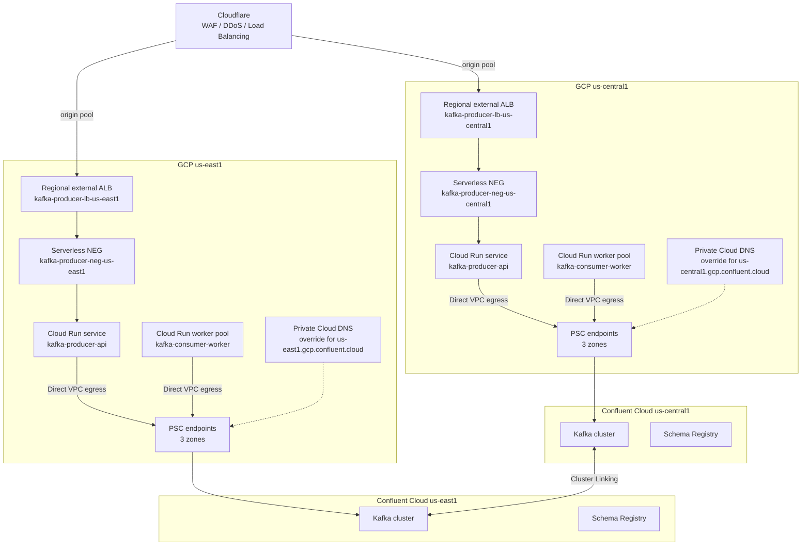

# Architecture

## Goals

- Keep Kafka traffic private. No public bootstrap endpoint, no VPC peering to Confluent.
- Keep the steady-state data path region-local. Cross-region traffic is for failover, not normal operation.
- Terminate public HTTP traffic at Cloudflare with WAF, DDoS protection, and Load Balancing.
- Run stateless HTTP producers on Cloud Run services and stream consumers on Cloud Run worker pools.
- Make the failure model explicit: at-least-once delivery, manual commits, idempotent consumers, and tested failover.
- Prioritize resilience over cost: warm capacity in more than one region, multi-zone Confluent clusters, and tested edge failover.

## Reference topology

Each region has the same building blocks:

| Component | Purpose |
| --- | --- |
| Cloudflare Load Balancing | Global public edge; selects a healthy regional origin pool |
| Cloudflare WAF and DDoS | Public edge security for the HTTP producer API |
| Regional external ALB | Region-local HTTPS ingress for Cloud Run |
| Serverless NEG | Connects the regional ALB backend to the regional Cloud Run service |
| Regional proxy-only subnet | GCP-managed proxy capacity for the regional external ALB |
| Confluent cluster | Local Kafka cluster with its own bootstrap endpoint and Schema Registry |
| PSC service attachment | Confluent-side private endpoint target, one per availability zone |
| PSC forwarding rule | GCP-side endpoint with a private IP address, one per zone |
| PSC Global Access | Cross-region access fallback while the endpoint region is healthy |
| Private Cloud DNS zone | Stable regional DNS name with one A record per PSC endpoint |
| Cloud Run Direct VPC egress | Places Cloud Run traffic on the VPC so it can reach the PSC IPs |
| Cloud Run service | HTTP producer API with request-driven scaling |
| Cloud Run worker pool | Kafka consumer with no HTTP endpoint, scaled by instances or lag |

## Why this shape

### Cloudflare at the public edge

Cloudflare already provides the organization's WAF, DDoS protection, and TLS policy. Using Cloudflare Load Balancing in front of regional GCP origins extends that control plane to regional failover:

- One public hostname, `producer.example.com`.
- One health-checked origin pool per region.
- One regional external ALB per region.
- One serverless NEG per regional Cloud Run service.

This avoids running a second global load balancer in GCP. The GCP ALBs stay regional and close to Cloud Run; Cloudflare handles global origin selection.

The tradeoff is that Cloudflare becomes the global ingress dependency. For tier-0, document and test a break-glass path that does not depend on the same Cloudflare load balancer.

If Cloudflare Load Balancing is not available, keep a GCP global external Application Load Balancer behind Cloudflare for regional failover. Cloudflare proxied DNS and WAF alone do not move traffic between origins.

### Private Service Connect instead of VPC peering

PSC gives one-directional private connectivity from the consumer VPC to the Confluent service attachment. It avoids CIDR overlap constraints, route propagation, and transitive routing problems that come with VPC peering. It also keeps the Confluent network boundary explicit.

Use PSC when:

- You need private connectivity without exposing a public endpoint.
- Your VPC address space is fixed or overlaps other networks.
- You want per-region endpoints with a stable private IP plan.

VPC peering is still valid for some organizations, but it requires non-overlapping CIDRs and careful route and firewall management across every VPC and region.

### Direct VPC egress instead of Serverless VPC Access connectors

Direct VPC egress gives Cloud Run instances an address from a VPC subnet without a connector VM. It is the preferred egress path for new deployments. It has a startup delay while the instance network is attached, which is why a startup probe matters.

Serverless VPC Access connectors still work but add managed connector capacity, cost, and another scaling layer.

### One cluster per region plus Cluster Linking

A single Confluent cluster reached from every region works for small deployments, but every produce and consume request crosses regions. That adds latency, cross-region egress cost, and a shared failure domain.

The resilience-first steady state is:

- One Confluent cluster in each active region.
- Producers and consumers connect to the local cluster.
- Bidirectional Cluster Linking replicates data between clusters.
- Consumer offset and ACL sync are enabled.
- Both regions stay warm. For tier-0, add a third region.
- Failover is still a deliberate Kafka operation: promote mirror topics and switch clients.

Active-active producers and consumers require deduplication and fencing. Do not run the same consumer group against both clusters without a split-brain control.

### Cloud Run services vs worker pools

| Workload | Cloud Run resource | Reason |
| --- | --- | --- |
| HTTP producer API | Service | Needs an HTTPS endpoint, concurrency, and request-based scaling |
| Background consumer | Worker pool | No HTTP traffic, no request concurrency, scales by instances or lag |
| One-off topic creation or connectivity check | Job | Runs to completion and exits |

A consumer can run as a service with a background loop, but a worker pool is a better fit. Worker pools do not expose an HTTP port and do not have request concurrency. See [Cloud Run lifecycle and scaling](cloud-run.md).

## Address plan

Use separate subnets for PSC endpoints, Cloud Run egress, and the regional ALB proxy-only subnet:

| Subnet | Example | Purpose |
| --- | --- | --- |
| PSC endpoint subnet | `10.10.0.0/26` | Three Confluent PSC endpoints, one per zone |
| Cloud Run egress subnet | `10.10.16.0/24` | Direct VPC egress addresses for Cloud Run instances |
| Regional proxy-only subnet | `10.10.32.0/23` | GCP-managed proxies for the regional external ALB |
| Cluster Linking / admin | Existing VPC routing | Control-plane and operational access |

Use non-overlapping per-region ranges, for example `10.11.0.0/26`, `10.11.16.0/24`, and `10.11.32.0/23` in `us-east1`.

Confluent requires a dedicated `/26` for the PSC service attachment. Do not overlap it with Cloud Run egress or on-premises ranges. Plan for growth in the Cloud Run subnet: each instance consumes an address from the egress subnet. Size the proxy-only subnet for normal traffic plus failover traffic.

## Request and data flow

### Produce

1. Client calls `https://producer.example.com`.
2. Cloudflare applies WAF and DDoS policy, then selects a healthy origin pool.
3. The regional external ALB forwards the request through its serverless NEG.
4. The regional Cloud Run service validates the payload and writes to the local Kafka cluster.
5. The producer uses `sasl_ssl`, idempotence, `acks=-1`, and `zstd`.
6. Cloud Run sends the packet through Direct VPC egress to a PSC endpoint IP.
7. The PSC endpoint forwards the request to the Confluent cluster in the same region.
8. The service returns `202 Accepted` with the topic, partition, and offset.

Cloudflare and the ALBs only handle HTTP. Kafka clients use the regional bootstrap endpoint, private DNS, and PSC directly.

### Consume

1. The worker pool starts and connects to the local cluster through PSC.
2. The consumer joins the group using `group.protocol=consumer` by default.
3. The library fetches batches and invokes `eachBatch`.
4. The handler processes each record, resolves its offset, and commits periodically.
5. On revoke, the rebalance callback commits resolved offsets before partitions move.
6. On SIGTERM, the worker stops fetching, commits, disconnects, and exits.

Consumer workers are not behind Cloudflare or the regional ALBs.

## Consistency and failure model

- Delivery is at-least-once. The producer is idempotent, but a failover or client retry can still create duplicates.
- Consumers must be idempotent. Key writes by `eventId`, an order ID, or another natural key.
- Offset commits happen after processing. A crash between processing and commit causes reprocessing.
- A partition revoke commits resolved offsets. Unresolved records are re-fetched by the next owner.
- Cluster Linking is asynchronous. Expect a non-zero replication lag and a small RPO during failover.
- Consumer group offsets are not a substitute for a failover plan. Validate offset translation or rewind behavior during a game day before relying on it.
- Cloudflare health checks affect HTTP routing only. They do not promote mirror topics, move offsets, or fence producers.
- Cloudflare cannot read Cloud Run service health. It only sees the `/readyz` response from the origin.
- A readiness endpoint that checks only process liveness will keep a Kafka-broken origin in rotation. Make `/readyz` include a bounded Kafka check.

## Decision log

| Decision | Choice | Rationale |
| --- | --- | --- |
| Kafka client | `@confluentinc/kafka-javascript` | Confluent-supported, librdkafka-based, KafkaJS-compatible API |
| Runtime | Node.js 22 on Debian slim | glibc prebuilt binaries; Node 22 is supported on Cloud Run |
| Producer semantics | Idempotent, `acks=-1`, `zstd`, `linger.ms=10` | Durable, ordered, efficient batching |
| Consumer semantics | Manual commit, batch processing, rebalance commit | Predictable at-least-once behavior |
| Commit strategy | Resolve per record, commit every N records | Bounds duplicate work while keeping commit overhead low |
| Rebalance protocol | `group.protocol=consumer`, classic fallback | New protocol is the Confluent default direction; classic is available for compatibility |
| Deployment split | Service for HTTP, worker pool for consumers | Matches Cloud Run billing and scaling models |
| Public edge | Cloudflare WAF, DDoS, and Load Balancing | Reuses the existing security layer; health-checked regional origin pools |
| Regional ingress | Regional external ALB plus serverless NEG | Keeps ingress region-local; Cloudflare handles global routing |
| Origin protection | Cloudflare IP allowlist or Authenticated Origin Pulls; Cloud Run ingress `internal-and-cloud-load-balancing` | Prevents bypass of the public edge |
| Resilience profile | Two active regions, warm capacity, multi-zone Confluent clusters | Prioritizes availability over cost; third region for tier-0 |
| Readiness | Kafka-aware `/readyz` | Cloudflare cannot see Cloud Run service health aggregation |

## Limits to verify before rollout

- Cloudflare Load Balancing plan limits, steering options, health-check intervals, and origin pool quotas.
- Cloudflare health-check behavior through WAF and origin protection rules.
- Regional external ALB proxy-only subnet capacity.
- PSC endpoint count per Confluent cluster and per region.
- Per-endpoint throughput and whether aggregate throughput meets your peak.
- Cloud Run Direct VPC egress subnet IP capacity.
- Cloud Run maximum instances and per-region quotas.
- Confluent cluster partition limits and Cluster Linking throughput.
- Schema Registry compatibility policy and regional replication strategy.

Cloud provider limits change. Confirm the current values in the Cloudflare, Confluent, and Google Cloud documentation for your regions and contract.

## References

- [Cloudflare Load Balancing](https://developers.cloudflare.com/load-balancing/)
- [Regional external Application Load Balancer with Cloud Run](https://docs.cloud.google.com/load-balancing/docs/https/setting-up-reg-ext-https-serverless)
- [Serverless NEGs](https://docs.cloud.google.com/load-balancing/docs/negs/serverless-neg-concepts)
- [Confluent Cloud private networking with PSC](https://docs.confluent.io/cloud/current/networking/private-links/gcp-psc.html)
- [Cloud Run Direct VPC egress](https://cloud.google.com/run/docs/configuring/private-networking)
- [Cloud Run worker pools](https://cloud.google.com/run/docs/configuring/workerpools)
- [Cloud Run services, jobs, and worker pools](https://cloud.google.com/run/docs/resource-model)
