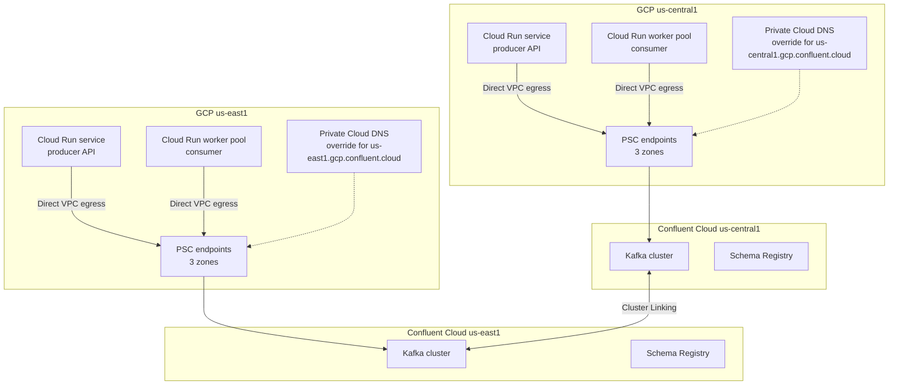

# Architecture

## Goals

- Keep Kafka traffic private. No public bootstrap endpoint, no VPC peering to Confluent.
- Keep the steady-state data path region-local. Cross-region traffic is for failover, not normal operation.
- Run stateless HTTP producers on Cloud Run services and stream consumers on Cloud Run worker pools.
- Make the failure model explicit: at-least-once delivery, manual commits, idempotent consumers, and tested failover.

## Reference topology

Each region has the same building blocks:

| Component | Purpose |
| --- | --- |
| Confluent cluster | Local Kafka cluster with its own bootstrap endpoint and Schema Registry |
| PSC service attachment | Confluent-side private endpoint target, one per availability zone |
| PSC forwarding rule | GCP-side endpoint with a private IP address, one per zone |
| PSC Global Access | Allows clients in other GCP regions to use the endpoint |
| Private Cloud DNS zone | Stable regional DNS name with one A record per PSC endpoint |
| Cloud Run Direct VPC egress | Places Cloud Run traffic on the VPC so it can reach the PSC IPs |
| Cloud Run service | HTTP producer API with request-driven scaling |
| Cloud Run worker pool | Kafka consumer with no HTTP endpoint, scaled by instances or lag |

## Why this shape

### Private Service Connect instead of VPC peering

PSC gives one-directional private connectivity from the consumer VPC to the Confluent service attachment. It avoids CIDR overlap constraints, route propagation, and transitive routing problems that come with VPC peering. It also keeps the Confluent network boundary explicit.

Use PSC when:

- You need private connectivity without exposing a public endpoint.
- Your VPC address space is fixed or overlaps other networks.
- You want per-region endpoints with a stable private IP plan.

VPC peering is still valid for some organizations, but it requires non-overlapping CIDRs and careful route and firewall management across every VPC and region.

### Direct VPC egress instead of Serverless VPC Access connectors

Direct VPC egress gives Cloud Run instances an address from a VPC subnet without a connector VM. It is the preferred egress path for new deployments. It has a startup delay while the instance network is attached, which is why a startup probe matters.

Serverless VPC Access connectors still work but add managed connector capacity, cost, and another scaling layer.

### One cluster per region plus Cluster Linking

A single Confluent cluster reached from every region works for small deployments, but every produce and consume request crosses regions. That adds latency, cross-region egress cost, and a shared failure domain.

The recommended steady state is:

- One Confluent cluster in each active region.
- Producers and consumers connect to the local cluster.
- Cluster Linking replicates data between clusters.
- Failover is a deliberate operation, not the normal data path.

### Cloud Run services vs worker pools

| Workload | Cloud Run resource | Reason |
| --- | --- | --- |
| HTTP producer API | Service | Needs an HTTPS endpoint, concurrency, and request-based scaling |
| Background consumer | Worker pool | No HTTP traffic, no request concurrency, scales by instances or lag |
| One-off topic creation or connectivity check | Job | Runs to completion and exits |

A consumer can run as a service with a background loop, but a worker pool is a better fit. Worker pools do not expose an HTTP port and do not have request concurrency. See [Cloud Run lifecycle and scaling](cloud-run.md).

## Address plan

Use separate subnets for the PSC endpoints and for Cloud Run egress:

| Subnet | Example | Purpose |
| --- | --- | --- |
| PSC endpoint subnet | `10.10.0.0/26` | Three Confluent PSC endpoints, one per zone |
| Cloud Run egress subnet | `10.10.16.0/24` | Direct VPC egress addresses for Cloud Run instances |
| Cluster Linking / admin | Existing VPC routing | Control-plane and operational access |

Confluent requires a dedicated `/26` for the PSC service attachment. Do not overlap it with Cloud Run egress or on-premises ranges. Plan for growth in the Cloud Run subnet: each instance consumes an address from the egress subnet.

## Request and data flow

### Produce

1. Client calls the Cloud Run producer service over HTTPS.
2. The service validates the payload and writes to the local Kafka cluster.
3. The producer uses `sasl_ssl`, idempotence, `acks=-1`, and `zstd`.
4. Cloud Run sends the packet through Direct VPC egress to a PSC endpoint IP.
5. The PSC endpoint forwards the request to the Confluent cluster in the same region.
6. The service returns `202 Accepted` with the topic, partition, and offset.

### Consume

1. The worker pool starts and connects to the local cluster through PSC.
2. The consumer joins the group using `group.protocol=consumer` by default.
3. The library fetches batches and invokes `eachBatch`.
4. The handler processes each record, resolves its offset, and commits periodically.
5. On revoke, the rebalance callback commits resolved offsets before partitions move.
6. On SIGTERM, the worker stops fetching, commits, disconnects, and exits.

## Consistency and failure model

- Delivery is at-least-once. The producer is idempotent, but a failover or client retry can still create duplicates.
- Consumers must be idempotent. Key writes by `eventId`, an order ID, or another natural key.
- Offset commits happen after processing. A crash between processing and commit causes reprocessing.
- A partition revoke commits resolved offsets. Unresolved records are re-fetched by the next owner.
- Cluster Linking is asynchronous. Expect a non-zero replication lag and a small RPO during failover.
- Consumer group offsets are not a substitute for a failover plan. Validate offset translation or rewind behavior during a game day before relying on it.

## Decision log

| Decision | Choice | Rationale |
| --- | --- | --- |
| Kafka client | `@confluentinc/kafka-javascript` | Confluent-supported, librdkafka-based, KafkaJS-compatible API |
| Runtime | Node.js 22 on Debian slim | glibc prebuilt binaries; Node 22 is supported on Cloud Run |
| Producer semantics | Idempotent, `acks=-1`, `zstd`, `linger.ms=10` | Durable, ordered, efficient batching |
| Consumer semantics | Manual commit, batch processing, rebalance commit | Predictable at-least-once behavior |
| Commit strategy | Resolve per record, commit every N records | Bounds duplicate work while keeping commit overhead low |
| Rebalance protocol | `group.protocol=consumer`, classic fallback | New protocol is the Confluent default direction; classic is available for compatibility |
| Deployment split | Service for HTTP, worker pool for consumers | Matches Cloud Run billing and scaling models |

## Limits to verify before rollout

- PSC endpoint count per Confluent cluster and per region.
- Per-endpoint throughput and whether aggregate throughput meets your peak.
- Cloud Run Direct VPC egress subnet IP capacity.
- Cloud Run maximum instances and per-region quotas.
- Confluent cluster partition limits and Cluster Linking throughput.
- Schema Registry compatibility policy and regional replication strategy.

Cloud provider limits change. Confirm the current values in the Confluent and Google Cloud documentation for your regions and contract.

## References

- [Confluent Cloud private networking with PSC](https://docs.confluent.io/cloud/current/networking/private-links/gcp-psc.html)
- [Cloud Run Direct VPC egress](https://cloud.google.com/run/docs/configuring/private-networking)
- [Cloud Run worker pools](https://cloud.google.com/run/docs/configuring/workerpools)
- [Cloud Run services, jobs, and worker pools](https://cloud.google.com/run/docs/resource-model)
